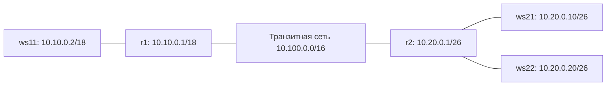

# Linux Networks

Учебная лабораторная работа Школы 21: настройка и диагностика сетей Linux. Результаты, конфигурации в скриншотах и пояснения собраны в отчёте.

**[Открыть полный отчёт →](report.md)**

## Что разобрано

- IPv4, подсети и маски с ipcalc.
- Статические маршруты: ip route и Netplan.
- Пропускная способность: iperf3.
- Правила iptables и диагностика через nmap.
- Маршрутизация между пятью VM: три рабочие станции и два маршрутизатора.
- DHCP, включая выдачу адреса по MAC.
- SNAT/DNAT и проверка прохождения трафика.
- SSH-туннели: local и remote TCP forwarding.

## Стенд маршрутизации

Транзитные адреса r1/r2: `10.100.0.11` и `10.100.0.12`. Схема соответствует стенду из части 5 отчёта; предыдущие части используют отдельные конфигурации.

## Материалы

- [Отчёт с командами и результатами](report.md).
- [Скриншоты](images).

Репозиторий документирует выполненную лабораторную. Образы VM и автоматическое развёртывание стенда не включены. Конфигурации сетевых интерфейсов следует воспроизводить на отдельных учебных машинах.
