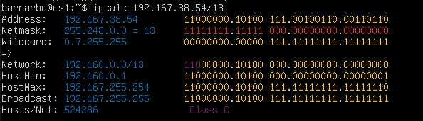
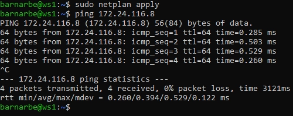
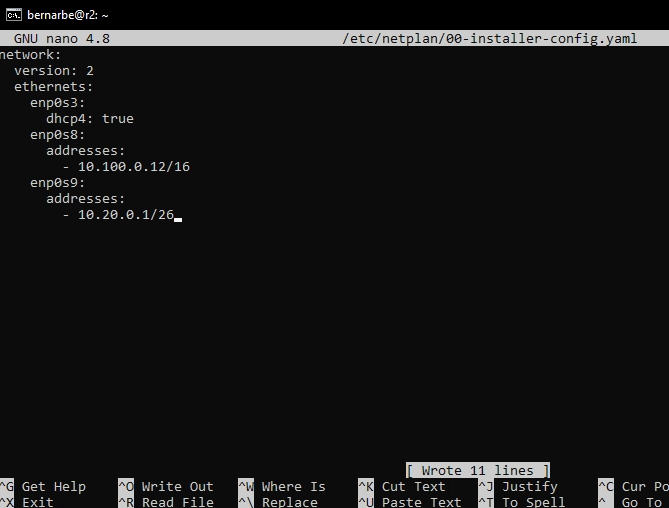

# Linux Network Report

## Part 1. Инструмент ipcalc

### 1.1. Сети и маски

- **1) Адрес сети 192.167.38.54/13:**

  - 

- **2) Перевод масок:**

  - 255.255.255.0 в двоичном виде: `11111111.11111111.11111111.00000000`
  - 255.255.255.0 в префиксном виде: `/24`
  - /15 в обычном виде: `255.254.0.0`
  - /15 в двоичном виде: `11111111.11111110.00000000.00000000`
  - 11111111.11111111.11111111.11110000 в обычном виде: `255.255.255.240`
  - 11111111.11111111.11111111.11110000 в префиксном виде: `/28`

  - 

- **3) Минимальный и максимальный хост в сети 12.167.38.4:**

  - Маска /8:
    - HostMin: `12.0.0.1`
    - HostMax: `12.255.255.254`
    - 

  - Маска 11111111.11111111.00000000.00000000 (/16):
    - HostMin: `12.167.0.1`
    - HostMax: `12.167.255.254`
    - 

  - Маска 255.255.254.0 (/23):
    - HostMin: `12.167.38.1`
    - HostMax: `12.167.39.254`
    - 

  - Маска /4:
    - HostMin: `0.0.0.1`
    - HostMax: `15.255.255.254`
    - 

### 1.2. localhost

- Диапазон адресов localhost: `127.0.0.1 — 127.255.255.255`
- **Можно** обратиться к localhost: `127.0.0.2`, `127.1.0.1`
- **Нельзя** обратиться к localhost: `194.34.23.100`, `128.0.0.1`

### 1.3. Диапазоны и сегменты сетей

- **1) Публичные и частные IP-адреса:**

  - 

  - Частные: `10.0.0.45`, `192.168.4.2`, `172.20.250.4`, `172.16.255.255`, `10.10.10.10`
  - Публичные: `134.43.0.2`, `172.0.2.1`, `192.172.0.1`, `172.68.0.2`, `192.169.168.1`

- **2) Возможные адреса шлюза для сети 10.10.0.0/18:**

  - 

  - Могут быть шлюзом: `10.10.0.2`, `10.10.10.10`, `10.10.1.255`
  - Не может быть шлюзом: `10.0.0.1` (не входит в сеть), `10.10.100.1` (выходит за пределы сети /18)

## Part 2. Статическая маршрутизация между двумя машинами

- Вывод команды `ip a` на ws1 и ws2 — список сетевых интерфейсов:

  - 

- Содержимое файла `/etc/netplan/00-installer-config.yaml` на ws1 (адрес 192.168.100.10/16):

  - 
  - 

- Содержимое файла `/etc/netplan/00-installer-config.yaml` на ws2 (адрес 172.24.116.8/12):

  - 

- Вывод команды `netplan apply` на ws1 и ws2:

  - 

### 2.1. Добавление статического маршрута вручную

- Добавление статического маршрута на ws1 командой `ip r add`:

  - 

- Добавление статического маршрута на ws2 командой `ip r add`:

  - 

- Пинг ws2 с ws1:

  - 

- Пинг ws1 с ws2:

  - 

### 2.2. Добавление статического маршрута с сохранением

- Содержимое изменённого файла `/etc/netplan/00-installer-config.yaml` на ws1 с постоянным маршрутом:

  - 

- Содержимое изменённого файла `/etc/netplan/00-installer-config.yaml` на ws2 с постоянным маршрутом:

  - 

- Применение `netplan apply` и пинг ws2 с ws1:

  - 

- Применение `netplan apply` и пинг ws1 с ws2:

  - 

## Part 3. Утилита iperf3

### 3.1. Скорость соединения

- 8 Mbps = **1 MB/s** (8 / 8 = 1)
- 100 MB/s = **800 000 Kbps** (100 × 8 × 1000 = 800 000)
- 1 Gbps = **1000 Mbps**

### 3.2. Утилита iperf3

- Запуск iperf3 в режиме сервера на ws2 и клиента на ws1, измерение скорости соединения:

  - 
  - 

## Part 4. Сетевой экран

### 4.1. Утилита iptables

- Содержимое файла `/etc/firewall.sh` на ws1 (стратегия: сначала DROP, затем ACCEPT):

  - 

- Содержимое файла `/etc/firewall.sh` на ws2 (стратегия: сначала ACCEPT, затем DROP):

  - 

- Запуск файла фаервола на ws1 командами `chmod +x /etc/firewall.sh` и `/etc/firewall.sh`:

  - 

- Запуск файла фаервола на ws2:

  - 

- **Разница между стратегиями:** iptables обрабатывает правила строго сверху вниз и останавливается на первом совпадении. На ws1 первым стоит правило DROP — пинг блокируется, правило ACCEPT никогда не достигается. На ws2 первым стоит правило ACCEPT — пинг разрешается, правило DROP никогда не достигается. Таким образом, результат определяется **порядком правил**, а не их наличием.

### 4.2. Утилита nmap

- Пинг ws2 с ws1 — ws2 не пингуется (DROP стоит первым на ws2... нет, ws1 не отвечает):

  - 

- Вывод nmap для машины которая не пингуется — `Host is up`:

  - 
  - 

## Part 5. Статическая маршрутизация сети

- Схема сети:

  - 

### 5.1. Настройка адресов машин

- Содержимое `/etc/netplan/00-installer-config.yaml` для ws11 (10.10.0.2/18):

  - 

- Содержимое `/etc/netplan/00-installer-config.yaml` для ws21 (10.20.0.10/26):

  - 

- Содержимое `/etc/netplan/00-installer-config.yaml` для ws22 (10.20.0.20/26):

  - 

- Содержимое `/etc/netplan/00-installer-config.yaml` для r1 (10.10.0.1/18, 10.100.0.11/16):

  - 

- Содержимое `/etc/netplan/00-installer-config.yaml` для r2 (10.100.0.12/16, 10.20.0.1/26):

  - 

- Пинг ws22 с ws21 — проверка связи внутри сети 10.20.0.0/26:

  - 

- Пинг r1 с ws11 — проверка связи внутри сети 10.10.0.0/18:

  - 

### 5.2. Включение переадресации IP-адресов

- Временное включение переадресации командой `sysctl -w net.ipv4.ip_forward=1` на r1:

  - 

- Временное включение переадресации командой `sysctl -w net.ipv4.ip_forward=1` на r2:

  - 

- Постоянное включение переадресации через `/etc/sysctl.conf` на r1:

  - 

- Постоянное включение переадресации через `/etc/sysctl.conf` на r2:

  - 

### 5.3. Установка маршрута по умолчанию

- Содержимое `/etc/netplan/00-installer-config.yaml` для ws11 с маршрутом по умолчанию через r1:

  - 

- Содержимое `/etc/netplan/00-installer-config.yaml` для ws21 с маршрутом по умолчанию через r2:

  - 

- Содержимое `/etc/netplan/00-installer-config.yaml` для ws22 с маршрутом по умолчанию через r2:

  - 

- Вывод `ip r` на ws11 — маршрут по умолчанию добавлен:

  - 

- Вывод `ip r` на ws21:

  - 

- Вывод `ip r` на ws22:

  - 

- Пинг r2 с ws11 и перехват трафика командой `tcpdump -tn -i enp0s8` на r2:

  - 
  - 

### 5.4. Добавление статических маршрутов

- Содержимое изменённого `/etc/netplan/00-installer-config.yaml` для r1 (маршрут в 10.20.0.0/26 через r2):

  - 

- Содержимое изменённого `/etc/netplan/00-installer-config.yaml` для r2 (маршрут в 10.10.0.0/18 через r1):

  - 
  - 

- Вывод `ip r` на r1 — таблица маршрутизации:

  - 

- Вывод `ip r` на r2 — таблица маршрутизации:

  - 

- Вывод команд `ip r list 10.10.0.0/18` и `ip r list 0.0.0.0/0` на ws11:

  - 

- **Почему для 10.10.0.0/18 выбран маршрут, отличный от 0.0.0.0/0:** Используется принцип **Longest Prefix Match** — маршрутизатор выбирает наиболее специфичный маршрут, то есть с наибольшей длиной маски. Маршрут `10.10.0.0/18` имеет маску `/18`, что длиннее `/0` маршрута по умолчанию, поэтому для пакетов в локальную сеть используется прямой маршрут через интерфейс, а не шлюз.

### 5.5. Построение списка маршрутизаторов

- Запуск `tcpdump -tnv -i enp0s8` на r1 и `traceroute 10.20.0.10` на ws11:

  - 
  - 
  - 

- **Принцип работы traceroute:** Утилита отправляет UDP-пакеты с последовательно увеличивающимся значением TTL (начиная с 1). Каждый маршрутизатор уменьшает TTL на 1, и когда TTL достигает 0 — отбрасывает пакет и отправляет ICMP-сообщение `Time Exceeded` обратно отправителю. Так traceroute узнаёт адрес каждого промежуточного хопа: TTL=1 → ответ от r1, TTL=2 → ответ от r2, TTL=3 → ответ от ws21. В дампе на r1 видны UDP-пакеты от ws11 с TTL=1,2,3 и соответствующие ICMP `time exceeded` ответы.

### 5.6. Использование протокола ICMP при маршрутизации

- Перехват ICMP-трафика на r1 командой `tcpdump -n -i enp0s8 icmp` и пинг несуществующего IP с ws11 командой `ping -c 1 10.30.0.111`:

  - 

## Part 6. Динамическая настройка IP с помощью DHCP

- Содержимое файла `/etc/dhcp/dhcpd.conf` на r2:

  - 

- Содержимое файла `/etc/resolv.conf` на r2 с прописанным `nameserver 8.8.8.8`:

  - 

- Перезапуск и статус службы DHCP на r2 командой `systemctl restart isc-dhcp-server`:

  - 

- Вывод `ip a` на ws21 после перезагрузки — машина получила адрес по DHCP:

  - 

- Пинг ws22 с ws21:

  - 

- Пинг ws21 с ws22:

  - 

- Содержимое `/etc/netplan/00-installer-config.yaml` на ws11 с указанием MAC-адреса `10:10:10:10:10:BA` и `dhcp4: true`:

  - 

- Содержимое файла `/etc/dhcp/dhcpd.conf` на r1 с жёсткой привязкой к MAC-адресу ws11:

  - 

- Содержимое файла `/etc/resolv.conf` на r1:

  - 

- Перезапуск и статус службы DHCP на r1:

  - 

- Вывод `ip a` на ws11 после перезагрузки — машина получила фиксированный адрес 10.10.0.2 по MAC-привязке:

  - 
  - 

- Вывод `ip a` на ws21 **до** обновления адреса:

  - 

- Освобождение IP на ws21 командой `sudo dhclient -r enp0s8`:

  - 

- Получение нового IP на ws21 командой `sudo dhclient enp0s8` и вывод `ip a` **после** обновления:

  - 

- **Использованные опции DHCP:**
  - `dhclient -r` — опция **Release**: освобождает текущий IP-адрес, отправляет DHCP серверу сообщение о том, что адрес больше не используется
  - `dhclient` — опция **Discover**: запускает полный цикл получения нового IP-адреса (DISCOVER → OFFER → REQUEST → ACK)

## Part 7. NAT

- Содержимое изменённого файла `/etc/apache2/ports.conf` на ws22 (`Listen 0.0.0.0:80`):

  - 

- Содержимое изменённого файла `/etc/apache2/ports.conf` на r1 (`Listen 0.0.0.0:80`):

  - 

- Запуск Apache командой `service apache2 start` на ws22 и r1:

  - 
  - 

- Содержимое файла `/etc/firewall.sh` на r2 — версия 1 (только базовые правила, FORWARD DROP):

  - 

- Проверка: ws22 не пингуется с r1 после применения правила FORWARD DROP:

  - 

- Содержимое файла `/etc/firewall.sh` на r2 — версия 2 (добавлено разрешение ICMP):

  - 

- Проверка: ws22 пингуется с r1 после добавления правила разрешения ICMP:

  - 

- Содержимое файла `/etc/firewall.sh` на r2 — финальная версия с SNAT и DNAT:

  - 

- Применение файла фаервола командами `chmod +x /etc/firewall.sh` и `/etc/firewall.sh`:

  - 

- Проверка SNAT: подключение с ws22 к Apache на r1 командой `telnet 10.10.0.1 80`:

  - 

- Проверка DNAT: подключение с r1 к Apache на ws22 через r2 командой `telnet 10.100.0.12 8080`:

  - 

## Part 8. Дополнительно. Знакомство с SSH Tunnels

- Запуск Apache на ws22 только на localhost — содержимое `/etc/apache2/ports.conf` со строкой `Listen localhost:80`:

  - 

- **Local TCP forwarding** с ws21 до ws22: команда `ssh -L 8080:localhost:80 bernarbe@10.20.0.20` на ws21 и проверка `telnet 127.0.0.1 8080` во втором терминале:

  - 

- **Remote TCP forwarding** с ws11 до ws22: команда `ssh -R 8080:localhost:80 bernarbe@10.20.0.20` на ws11 и проверка `telnet 127.0.0.1 8080` во втором терминале:

  - 
